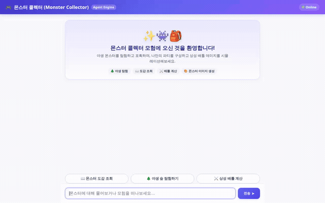

# 🎮 몬스터 콜렉터 (Monster Collector) Agent



Google Agent Platform 및 Google GenAI SDK를 기반으로 구축된 **몬스터 콜렉터(Monster Collector)** 대화형 AI 에이전트입니다. 플레이어와의 대화를 통해 몬스터 도감 조회, 야생 몬스터 탐험 및 포획, Imagen 기반의 고화질 몬스터 일러스트 생성, 장기 기억(Memory Bank) 기반 맞춤형 어드바이스를 제공합니다.

---

## 🌟 주요 기능 및 구현 현황

### 1. 실제로 구현된 기능 (Implemented)
- **장기 기억 (Vertex AI Memory Bank)**
  - `PreloadMemoryTool` 및 `generate_memories_callback`을 통한 세션 간 트레이너 정보/선호도 자동 동기화
  - `memory_bank_service_builder`를 통해 Agent Platform Memory Bank 인스턴스와 직접 연동
- **데이터베이스 연동 (Google Cloud Firestore)**
  - `list_monsters`: 속성별(불, 물, 풀 등) 몬스터 목록 및 기본 스탯 쿼리
  - `get_monster_detail`: 특정 몬스터의 상세 정보, 스탯, 스킬, 서식지 조회
  - `get_player_profile`: 트레이너 프로필, 소지 골드, 현재 파티 Roster 및 컬렉션 조회
  - `catch_monster`: 야생 몬스터 포획 및 플레이어 컬렉션/파티에 즉시 반영
  - `list_wild_areas` / `explore_wild_area`: 야생 지역 탐험 및 확률 기반 야생 몬스터 조우(Encounter)
- **외부 공개 API 연동 (PokeAPI REST)**
  - `lookup_pokemon_api`: 공개 PokeAPI를 연동하여 공식 포켓몬 데이터(타입, 스탯, 공식 아트워크 URL) 조회
- **AI 이미지 생성 및 스토리지 연동 (Google GenAI & Cloud Storage)**
  - `generate_monster_image`: `gemini-3.1-flash-lite-image` 모델을 활용한 고화질 몬스터 일러스트 생성
  - 생성된 이미지를 Google Cloud Storage(GCS) 공개 버킷에 자동 업로드하고, 프론트엔드 및 ToolContext Artifact로 제공
- **리치 UI 카드 렌더링 (A2UI)**
  - `a2ui_callback` 및 schema manager를 통한 Card, Column, Row, Text, Image 컴포넌트 실시간 JSON 렌더링
  - 웹 프론트엔드에서 몬스터 도감 및 생성된 일러스트를 대화형 카드로 표시
- **코드 실행 환경 (Agent Engine Sandbox Code Executor)**
  - `AgentEngineSandboxCodeExecutor`가 연결되어 복잡한 연산 및 파이썬 코드 실행 지원

### 2. 계획됨 (미구현) 항목 (Planned)
- **Google Maps 기반 장소 탐색 (`GOOGLE_MAPS_API_KEY` 의존)**:
  - `geocode_location` 및 `search_nearby_places` 함수는 구현되어 있으나, Google Maps API 키 발급 및 활성화가 계획 단계(미구현)에 있습니다.
- **아이템 상점 및 골드 구매 (`purchase_items`)**:
  - `project_brief.md`에 기획되었으나 아이템 결제/소모 로직은 추후 확장 기능으로 계획됨(미구현).
- **상성 데미지 공식 턴제 시뮬레이션 고도화**:
  - 기본 파이썬 샌드박스를 활용한 계산은 가능하나, 전용 배틀 턴제 상태 머신 및 실시간 턴제 UI 표시는 계획됨(미구현).

---

## 🛠️ 기술 스택 및 아키텍처

- **에이전트 프레임워크**: `agents-cli 1.4.0` / Google Agent Development Kit (ADK)
- **기본 모델**: `gemini-3.6-flash` (Vertex AI Global)
- **이미지 생성 모델**: `gemini-3.1-flash-lite-image` (Vertex AI Global)
- **데이터베이스**: Google Cloud Firestore (Native Mode)
- **오브젝트 스토리지**: Google Cloud Storage (Public Bucket)
- **장기 메모리**: Google Cloud Vertex AI Memory Bank
- **프론트엔드**: FastAPI A2A Reverse Proxy + Responsive Vanilla Chat UI (A2UI Renderer 내장)

---

## 🚀 로컬 실행 및 설치 안내

### 1. 사전 요구 사항
- Python 3.11 이상
- [uv](https://docs.astral.sh/uv/) 패키지 매니저
- Google Cloud SDK (`gcloud` CLI) 로그인 및 프로젝트 설정
  ```bash
  gcloud auth login
  gcloud auth application-default login
  gcloud config set project YOUR_PROJECT_ID
  ```

### 2. 의존성 설치
프로젝트 루트 디렉토리에서 필요한 패키지를 설치합니다:

```bash
# Agent CLI 및 프로젝트 의존성 동기화
uv sync
```

### 3. 로컬 에이전트 실행 (Playground)
ADK 개발자 인터페이스(Web Playground)를 통해 에이전트를 테스트합니다:

```bash
uv run adk web app
```
브라우저에서 안내되는 로컬 포트로 접속하여 몬스터 도감, 메모리, 이미지 생성 기능을 바로 확인하실 수 있습니다.

### 4. 로컬 전용 웹 프론트엔드 실행
A2UI 렌더러와 맞춤형 디자인이 적용된 프론트엔드 서버를 구동합니다:

```bash
cd frontend

# 가상환경 생성 및 프론트엔드 의존성 설치
uv sync

# 프론트엔드 프록시 서버 시작
export AGENT_ENGINE_RESOURCE_NAME="projects/YOUR_PROJECT_NUMBER/locations/YOUR_REGION/reasoningEngines/YOUR_ENGINE_ID"
export AGENT_DIRECTORY="app"
uv run uvicorn main:app --host 0.0.0.0 --port 8080
```

---

## 📂 프로젝트 구조

```
monster-collector/
├── agents-cli-manifest.yaml   # Agent Engine 배포 매니페스트 (A2A 프로토콜 활성화)
├── deployment_metadata.json   # 배포된 Agent Engine 리소스 메타데이터
├── pyproject.toml             # 에이전트 프로젝트 의존성 정의
├── app/                       # 핵심 에이전트 로직
│   ├── agent.py               # 루트 에이전트, 메모리 서비스, 코드 실행기, A2UI 콜백
│   ├── tools.py               # Firestore DB 쿼리, GCS 업로드, 이미지 생성 도구
│   ├── a2ui_utils.py          # A2UI 데이터 파트 추출 및 서피스 이벤트 콜백
│   └── a2ui_prompt.txt        # A2UI 카드 포맷 지침
├── frontend/                  # 사용자 채팅 웹 프론트엔드
│   ├── main.py                # FastAPI A2A 통신 프록시
│   ├── requirements.txt       # 프론트엔드 의존성
│   └── static/
│       └── index.html         # 리치 A2UI 렌더러 및 게임 테마 반응형 채팅 UI
└── docs/
    └── images/
        └── demo.gif           # 에이전트 시연 루핑 GIF 애니메이션
```
